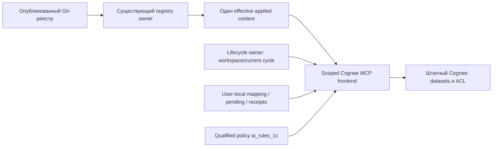

# G4: конкретный план реализации памяти

## Семантическая поправка, 2026-10-26

Этот документ сохраняет исходный одобренный план/реализацию G4 старой модели.
Нынешняя цель — common connection без пользовательского ACL; прежние
admin-prepared/grants/private backend требования superseded, а не новые условия.
[Точная сверка G4](g4-common-connection-alignment.md) называет совместимость existing configuration,
[новый G5](g5-qualification-plan.md) — конечный native план. Сверка не требует
новой source-адаптации или переоткрытия G4; native часть остаётся G5.
Код, стенд, G5/Gate6, рабочая миграция и публикация не изменяются.

Статус 2026-10-26: **план одобрен, исходная реализация G4 выполнена; G5 не начат**.
[Фактическая source-матрица и регистрационная граница](evidence/g4-source-implementation-2026-10-26.md).
Действует одобренный D9, новая архитектура хранения не предлагается.
Gate 6, рабочая миграция и публикация workflow остаются вне поручения.
Шаги сохраняют одобренную последовательность; фактический proof и открытый G5
указаны в общей матрице. Это не новая программа G3.

## Исходная граница

| Основание | Подтверждённое состояние | Следствие для G4 |
|---|---|---|
| D9 | Одобрен пользователем 2026-10-19; owners/state/recovery определены в design | Не согласовывать заново те же границы. Новый coordinator, backend patch, elevation или иной владелец требуют отдельного пересмотра |
| G1 / Q1–Q7 | Native REST qualification этапов B/C passed для Cognee 1.6.5 и exact local profile; original failed Q5 сохранён | Повторно использовать совпадающие доказательства, а не начинать все Q заново. Adapter и установленный workflow ими не приняты |
| G2 / G3 | Reader/resolver квалифицирован; G3 закрыт в PM5/Win11/Kilo/Cursor контуре, Codex только core/API | Использовать одного registry/client owner; R1–R5 не превращать в новый входной барьер всего G4 |
| R6 | Опубликован `0274a8ffb5a03ba7b856736c2b4a637ccbe98b73`, восемь типовых проектов, 44 области; [квитанция](../add-product-project-registry/evidence/r6-publication-2026-10-25.md) | Это начальное опубликованное основание consumer. Следующие ревизии приходят обычным registry update; память не закрепляет этот SHA навсегда и не fetch-ит каталог сама |
| Canonical homes | В опубликованном R6 нет назначенных memoryHomeProductId; отложено владельцем осознанно | Shared product remember не включать по догадке. Поддержку home реализовать; действующий общий маршрут появится только после подтверждённой карты и native grants |
| ai_rules_1c | Текущий source lock: r47 `itl-main-2f640143-r47`, commit `c91682404a498f356810b179ce8336711a411170`, upstream `2f640143756ecd01fed42100e412632aa9082385` | Semantic diff строить от этого точного fork, не от исторического r43. Запись compatibilityStatus в lock не доказывает совместимость ещё не написанной памяти |

Проверенный local G1 artifact: `qualification-result-r2.json` run
`cognee-q5-q7-r2-20261019T094637Z-b4127852`, SHA-256
`be8219d1d090343f2d7deebace513b77d5aa7a322e353f10b9f3324d7048582d`.
Он совпал при подготовке плана. Image
`sha256:e5de80619fd8d0c53cdaca2aea6020b046f57f8800e62120faa50807fa4f3820`,
OpenAPI SHA-256 `b863f72d912c07ceb4bb914d790152659427c0ad33863d553d38b5fa64e24171`,
authenticated/backend-ACL profile, GLiNER и fastembed `BAAI/bge-small-en-v1.5`.
Профиль доказывает native возможности; качество русского/BSL и экономия — будущий G5.
Работающий стенд, доступность его endpoint и свежесть auth сейчас не проверялись.
Его loopback 18190 — адрес qualification, не автоматически сетевой production endpoint.

## Что именно реализуется

Один context-bound stdio MCP frontend над неизменённым сетевым Cognee.
Планируемая первая поставка — PowerShell 5.1 leaf и native REST transport:
без требования Python/Cognee SDK на каждом рабочем месте. Используются обычный
client launcher, UTF-8 и штатные quoting/process helpers; процесс живёт в контексте
MCP-клиента, а не как Windows service или machine-wide broker.
Имена новых leaf-файлов ниже — предлагаемые точки реализации; окончательная
внутренняя раскладка не меняет owners D9.

В common MCP settings находится Cognee descriptor и личный выбор пользователя.
В business catalog остаются только code/graph/productDocs; четвёртой роли нет.
Provider-local mapping хранит instance/principal/exact dataset ID/owner отдельно
от реестра. Secrets не передаются в аргументах процесса, заметках или Git.
Доступ внутри сети сам по себе не является grant.

## Шесть областей

| Область | Стабильный ключ | Dataset label | Что в ней сохраняется |
|---|---|---|---|
| Задача + ветка + база | workspaceId + cycleId | itl_task_<cycleId> | Наблюдения и решения текущего цикла; после reset только явная история |
| Локальный проект | workspaceId | itl_workspace_<workspaceId> | Устойчивые особенности этой установки; переживают reset |
| Рабочее место | developerId + machineId | itl_workplace_<workplaceId> | Личные особенности tooling на этом ПК; RDP session не отдельная область |
| Продукт/конфигурация | productId и подтверждённая knowledgeArea/home | itl_product_<productId> | Продуктовые факты с применимостью/ограничениями; без переноса между PM4/PM5 по имени |
| Проект | projectId | itl_project_<projectId> | Правила внедрения, клиентские изменения и устойчивые project corrections |
| Организация | organizationId | itl_org_<organizationId> | Проверенные общие факты для пользователей с native grants |

Это шесть назначений, не шесть копий одного факта и не шесть отдельных сервисов.
Private datasets создаются лениво под подтверждённым пользователем; shared
product/project/organization datasets готовит назначенный администратор Cognee.
Одинаковый label другого владельца не заменяет shared exact ID.

Сначала выбирается наименее широкая достаточная область. При неопределённой
применимости/home факт остаётся task/project candidate. Организационный факт
не публикуется автоматически из частного проекта. В R6 все типовые проекты
customized=false; внешние проекты не выдумываются для canary.
Область выбирает основной агент по известным правилам, без второй LLM и без
обязательного вопроса человеку на каждую заметку.

## Конечная последовательность G4

| Шаг | Зависимость / изменение | Готовый результат и существующая приёмка |
|---|---|---|
| G4.0 — закрепить входы | После явного разрешения apply: актуальные source/fork pins, применимость G1 profile, контракт native exact-ID read/write/original/status, существующий registry DTO; согласовать используемые runtime leaf assets с D9 | Нет расширения архитектуры; descriptor/учётная запись/readiness имеют конкретное продолжение. При совпавшем profile reused Q proof; при отличии проверяется только затронутая возможность до зависимого кода. Задачи 1.1–1.7 уже closed, не открываются механически |
| G4.1 — identity и scope resolver | Workspace/developer/workplace IDs, provider-local mapping, allowed read/write sets над effective context и grants; shared datasets не создаются под личным владельцем | Шесть типов scope, explicit destination, subset/no-default-global; home отсутствует → candidate. Задачи 2.1/2.2, 4.1/4.3; AC-01–05/18/20/31–33/35 |
| G4.2 — native frontend и точная запись | Stdio remember/recall/status и только нужные supported correction/retirement операции; тот же qualified REST contract по exact IDs; note envelope, private pending и receipts | Durable/indexing/rejected/unconfirmed различаются; body-loss/restart сначала exact lookup, без слепого повторного remember. Оригинал/current status независимы от semantic hits. Задачи 2.3–2.6; AC-06–09/19/33/34 |
| G4.3 — ограниченный retrieval | Один CHUNKS query по объединению разрешённых IDs, scope до graph; source/status/applicability проверка до выдачи агенту | До 24 raw candidates → до 8 карточек/1600 фактических токенов; read 20 s, write/status 60 s суммарно. Cap/timeout → честный partial, не «знаний нет». Задачи 5.1/5.2/5.5; AC-24–26/36/37 |
| G4.4 — cycle и локальное продолжение | Existing lifecycle records: initial/current/reserved cycle, activate только при successful reset; отдельные компактные continuation/pending refs вне reset tree | Initial enable не меняет базу/HEAD; повтор/disable-enable не создаёт новый cycle; resume сохраняет reserved ID; old chat не пишет в новый scope. Задачи 3.1–3.5; AC-10–14/23/31/40. В G4 — owner fixtures, без Gate 6 и установленной рабочей миграции |
| G4.5 — совместимый fork/host route | Отдельный controlled-fork candidate от текущего lock, затем согласованный USER-RULES.append.md; никакого patch установленной копии | Сохранены upstream triggers/TOOL/native calls/query budget/Memory line и один durable save; private fallback доступен новому чату. Задачи 4.4–4.6; AC-21–23/31. Managed enable ждёт согласованной пары fork + host |
| G4.6 — подключение и отключение | Existing registry/MCP client owner: separate opt-in после association, context-bound managed entry, штатный reload и pinned resume/owned restore | Later/off/unattended сохраняют прежний режим. Нет второго updater/fetch или повторного выбора проекта; disable сохраняет данные/receipts/External MCP. Задачи 4.2/4.7/4.8, 5.3/5.4; AC-15–17/21/27/28/35/39/41–43 |
| G4.7 — source приёмка и handoff | Один законченный workflow change и отдельный fork change у его владельца; непосредственно затронутые owner regressions, затем обычная регистрация | Реализация и fixtures готовы к G5. Existing frozen B01–B12 не меняется ради результата; нет нового G3 gate или публикации workflow. Задачи 6.1/6.5; native/installed/paired proof остаются отдельным G5 |

Шаги не означают обязательный commit/Targeted после каждого пункта. Их цель —
показать зависимости. Изменения одного законченного поведения объединяются;
RegisterChange владеет единственным Targeted соответствующего source change.

## Точки изменений и владельцы

| Контур | Планируемые файлы / существующие точки | Ограничение |
|---|---|---|
| Memory leaf ITL MCP owner | Новые `scripts/lib/agent-1c.memory.ps1` и `scripts/cognee-memory-mcp.ps1` внутри `.agents/skills/1c-workflow`; для объёма допустимо разделить stateless model и REST transport внутри этого же leaf | Не новый IAM, SQL/versioning store, process broker, shared lock или background replay |
| Registry consumer | `agent-1c.product-project-context.ps1`: существующие `Get-ItlProductProjectOperationContext`, `Get-ItlProductProjectEffectiveSnapshot` и resolver `agent-1c.product-catalog.ps1` | Потребить один effective snapshot: project/product/customizations, roles/source origin, settingsHash/knowledgeHash, applicability. Свои fetch/renderer/verifier/lineage policy не добавлять |
| Client config | `Write-Vibecoding1cMcpClientConfig` и прежние client adapters/apply/recovery receipts | Добавить только managed memory binding и поддержку readonly readiness; защита custom/disabled/External MCP остаётся прежней |
| Lifecycle | `agent-1c.lifecycle.ps1`: branch state writer, `New-DevBranchCore`/`Reset-DevBranch`/resume | Хранит и активирует cycle; memory leaf читает результат. Реальные verification/installed status не выводятся из памяти |
| Packaging | Прежние managed-copy/asset lists и owner content checks для новых leaf файлов | Root AGENTS, OpenSpec и секреты не попадают в installed copy. Нет нового обязательного Python/runtime provisioner |
| Policy fork | `content/rules/project-memory.md`, placed-once `memory.md`, при необходимости `content/rules/memory-setup.md` и provider reference; manifest/tests у fork owner | Новый upgrade/release candidate от exact r47; upstream baseline не переписывать, установленную копию не патчить, publication отдельно |
| Host policy bridge | `templates/USER-RULES.append.md` и controlled-fork intake/compatibility metadata | Только binding/ownership/условный qualified fallback; не вторая полная memory policy |

### Минимальное личное состояние

Один existing user-local ITL root вне tracked/reset tree: workspace/developer/workplace
identity и locator; provider instance/principal/dataset mapping; компактный
checkpoint с goal/constraints/next step/proof refs; scoped pending и receipts.
Настоящий current/reserved cycle остаётся в прежних lifecycle records.
Независимая копия workspace получает новый ID, перенос сохраняет его явно;
переименование проекта или новая RDP session не меняют принадлежность знаний.
Кеш контекста — прежнего registry owner; новый кеш результатов recall в первом
срезе не нужен. Повторное использование ответа в неизменном сеансе следует policy,
но не является доказательством текущих grants после revoke/restore.

`remember` требует явный допустимый dataset_name; scope проверяется до backend.
Note envelope: noteId, scope, date/status, origin, knowledgeArea/applicability,
evidence/source revision и supersedes при наличии. В receipt — точный provider
data/dataset ID и фактический исход. Durable confirmation предшествует удалению
pending. Unknown outcome сначала reconcile, без exactly-once обещаний.

## Совместимость с ai_rules_1c

В exact r47 прочитан `content/rules/project-memory.md`: managed ITL boundary ещё
исключает Cognee/OpenViking и называет templates project-scoped. В то же время
действующий `USER-RULES.append.md` правильно ограничивает templates общими,
неконфиденциальными фактами и направляет project corrections в root memory.md.
Это известный D7 owner-local разрыв; наличие MCP само по себе его не исправляет.

| Сохранить | Ограниченная согласованная адаптация |
|---|---|
| Memory-only route и загрузка policy по триггеру; recall-first/correction-capture/rule-friction | Qualified opt-in допускает Cognee только при проверенном scoped binding; legacy/off остаются отдельным прежним режимом |
| TOOL off/auto/required, раздельная готовность read/write | `required` gap останавливает зависимую memory operation; отсутствие binding не обходится общей templates памятью |
| Cognee → OpenViking → templates, один durable save | Порядок среди допустимых writers; private заметки не уходят в shared templates. Unconfirmed outcome не запускает fallback-дубликат |
| Full-cycle/spec — все eligible readers; quick-fix/standing — первый | Один Cognee recall по union IDs вместо шести scope queries; standing query один раз на unchanged session context, одна reformulation только после пустого relevant answer |
| Native-shaped remember/recall(CHUNKS) и честная Memory line | Explicit dataset_name в qualified route; фактические durable/indexing/unconfirmed, не обещание сохранить по одному вызову |
| Четыре критерия strict root memory.md и только explicit evolve | Обычные qualified project/workspace corrections уходят в durable scope либо private pending вне reset tree; root не превращается в transcript/очередь |
| Shared templates только для verified/non-confidential cross-project facts | Исправить misleading project-scoped wording у fork owner, согласовав host overlay; установка OpenViking и зеркалирование не нужны |

Semantic diff проверяет trigger → требуемое действие → исключения → precedence →
failure outcome. Внешние OpenViking entries сохраняются; managed route использует
его только при отдельно qualified scope. Нет автоматического rules upgrade,
тихого opt-in или настройки второго движка. Новый совместимый fork asset/pin
квалифицируется своим owner; текущий r47 не объявляется поддерживающим новый route.

## Что должно быть готово до настоящего enable / G5

1. Явное разрешение реализации G4, затем отдельный допуск native/installed canary.
   Это не запрос новой архитектуры D9 и не разрешение менять рабочие установки.
2. Доступный qualification endpoint с применимыми version/image/schema/auth/model
   identities; при остановленном стенде не делать вид, что он работает. Native
   общие IDs — техническая подготовка тем же common account, без grants людям.
3. Для shared-product сценария — отдельно подтверждённые homes в registry и
   admitted exact IDs. Пока homes отсутствуют, код общего маршрута проверяется
   fixtures, shared-product runtime не включается; остальные срезы G4 не блокируются.
4. Совместимая пара fork/host и source candidate; у client owner подтверждённый
   tool catalog после reload. До этого readiness не объявляется enabled.

Q5 реализуется прежней процедурой admin close → restore → current originals и
известные поздние correction/delete → native current original/status → reopen только
подтверждённых scopes; client owner сбрасывает их cache/context. Неподтверждённая
область закрыта, независимая задача продолжается. Скрытый rollback не обнаруживается
новым ITL сервисом. Q7 сохраняет self_improvement=false, native graph и whole-run
accounting; неизвестные внутренние token/cost значения не объявляются нулём.

## Конечная граница готовности G4

- Реализованы все шесть scope types, explicit destination, exact native ID mapping,
  bounded recall/currentness, durable/unconfirmed receipts и source-preserving corrections.
- Cycle/continuation/pending используют D9 owners и переживают reset/new session;
  initial enable не меняет базу и не подменяет proof проверки/установки.
- Qualified fork/host route согласован, legacy/off/custom/External MCP сохранены;
  данные читаются из одного effective registry context без дополнительного startup fetch.
- Непосредственно затронутые owner regressions пройдены, source commit зарегистрирован
  штатным helper. Предлагается одна новая owner suite `ScopedCogneeMemory.Tests.ps1`
  для meaningful scope/durability/currentness boundaries плюс затронутые существующие
  ProductProject/McpConfig/Lifecycle/AiRules suites; точный выбор делает gate owner.
- Native G1, source fixtures, client configuration и будущий G5 evidence названы
  раздельно. G4 закончился, когда source candidate готов к G5; не после полного
  rollout и не после перебора новых несогласованных комбинаций.

G5 использует существующий frozen corpus: 37 synthetic notes / 6 scopes,
B01–B12, manifest `b0cc2bcf94e06e7f6c504c0243c41af6e5f8e280d88a4ec2dade523d1f66ec3b`.
В G4 он не импортируется для массового remember и не меняется ради результата.
Native frontend/installed canary, русский/BSL retrieval и paired whole-task
files-only/Cognee cost/quality/rework остаются прежними задачами 6.2–6.4/6.6b.
UTF-8 bytes — только помеченная proxy при отсутствии tokenizer; это не измеренные
токены и не доказательство выполнения 1600-token бюджета. Точный счёт/сокращение
карточек входит в реализацию и последующую проверку D8, без ослабления лимита.

Rollback — прежний client owner disable/owned restore, сохранить datasets,
IDs, old notes, pending и receipts; файлы/обычный reset остаются доступны.
Поддержка Windows 10/11/Server 2019+, PS5.1 и terminal sessions сохраняется;
отсутствующие реальные proof остаются UNVERIFIED, не превращаются в новые
G3 canary или автоматическое сокращение поддержки. OpenCode пропущен по прежнему
решению пользователя; Kilo/Cursor и Codex core/API не объявляются live memory proof.

## Историческая граница поручения подготовки, 2026-10-25

Никакого кода/новых runtime файлов, изменения fork/lock, запуска Cognee/tests,
создания datasets/пользователей/grants, новых homes или публикации реестра.
Gate 6, рабочие проекты и публикация workflow не затрагиваются. Документация
плана может пройти обычный commit/RegisterChange; это не начало реализации G4.
